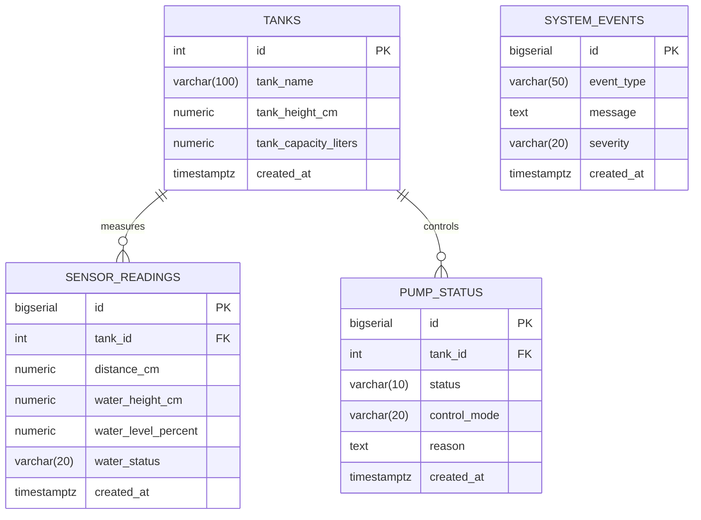

# PostgreSQL Database Architecture & Schema Specification

## 1. Database Overview
- **Database Engine**: PostgreSQL 14+ / 18+
- **Database Name**: `smart_water_monitoring`
- **Default Port**: `5432`
- **Connection Strategy**: Parameterized Connection Pool (`pg.Pool`) via Node.js
- **Scope**: Single physical prototype water tank (**Tank 1**, calibrated 20 cm height, 10.0 Liters gross capacity). Strictly relational design — no MongoDB or unindexed document stores.

---

## 2. Entity-Relationship Model



---

## 3. Detailed Table Specifications

### 3.1 `tanks` (Tank Configuration & Geometry)
Stores calibrated physical tank dimensions. Single-tank prototype constraint enforced.

| Column | Data Type | Constraints | Description |
| :--- | :--- | :--- | :--- |
| `id` | `SERIAL` | `PRIMARY KEY` | Unique Tank Identifier (Fixed to `1`) |
| `tank_name` | `VARCHAR(100)` | `NOT NULL` | Human-readable name (`"Tank 1"`) |
| `tank_height_cm` | `NUMERIC(6, 2)` | `NOT NULL, CHECK (> 0)` | Calibrated physical height ($20.00\text{ cm}$) |
| `tank_capacity_liters` | `NUMERIC(8, 2)` | `NOT NULL, CHECK (> 0)` | Calibrated gross volume ($10.00\text{ L}$) |
| `created_at` | `TIMESTAMPTZ` | `DEFAULT CURRENT_TIMESTAMP` | Initial configuration creation timestamp |

### 3.2 `sensor_readings` (Time-Series Ultrasonic Telemetry)
Stores raw and derived ultrasonic measurements transmitted from the ESP32.

| Column | Data Type | Constraints | Description |
| :--- | :--- | :--- | :--- |
| `id` | `BIGSERIAL` | `PRIMARY KEY` | Sequential measurement record ID |
| `tank_id` | `INTEGER` | `NOT NULL, REFERENCES tanks(id)` | Foreign key link to `tanks` |
| `distance_cm` | `NUMERIC(6, 2)` | `NOT NULL, CHECK (>= 0)` | Ultrasonic air gap from transducer to water surface |
| `water_height_cm` | `NUMERIC(6, 2)` | `NOT NULL, CHECK (>= 0)` | Liquid column height ($H = H_{\text{tank}} - d$) |
| `water_level_percent` | `NUMERIC(5, 2)` | `NOT NULL, CHECK (0 to 100)` | Fill percentage ($0\%$ to $100\%$) |
| `water_status` | `VARCHAR(20)` | `NOT NULL, CHECK IN ('LOW', 'NORMAL', 'FULL')` | Calibrated status classification |
| `created_at` | `TIMESTAMPTZ` | `DEFAULT CURRENT_TIMESTAMP` | Ingestion timestamp with timezone |

### 3.3 `pump_status` (Actuator Audit Trail)
Audits confirmed physical relay state transitions received from the ESP32 firmware.

| Column | Data Type | Constraints | Description |
| :--- | :--- | :--- | :--- |
| `id` | `BIGSERIAL` | `PRIMARY KEY` | State transition audit record ID |
| `tank_id` | `INTEGER` | `NOT NULL, REFERENCES tanks(id)` | Foreign key link to `tanks` |
| `status` | `VARCHAR(10)` | `NOT NULL, CHECK IN ('ON', 'OFF')` | Confirmed physical relay state |
| `control_mode` | `VARCHAR(20)` | `NOT NULL, CHECK IN ('AUTO', 'MANUAL')` | Active control operating mode |
| `reason` | `TEXT` | `NOT NULL` | Context or trigger that caused state change |
| `created_at` | `TIMESTAMPTZ` | `DEFAULT CURRENT_TIMESTAMP` | Transition confirmation timestamp |

### 3.4 `system_events` (Operational Alerts & Audit Logs)
Records real-time warnings, low water alerts, hardware connectivity events, and audit logs.

| Column | Data Type | Constraints | Description |
| :--- | :--- | :--- | :--- |
| `id` | `BIGSERIAL` | `PRIMARY KEY` | Unique event audit ID |
| `event_type` | `VARCHAR(50)` | `NOT NULL` | Event classifier (e.g., `WATER_LOW_ALERT`) |
| `message` | `TEXT` | `NOT NULL` | Detailed description of the event |
| `severity` | `VARCHAR(20)` | `NOT NULL, CHECK IN ('INFO', 'WARNING', 'CRITICAL', 'ERROR')` | Severity level classification |
| `created_at` | `TIMESTAMPTZ` | `DEFAULT CURRENT_TIMESTAMP` | Event trigger timestamp |

---

## 4. Performance Indexing Strategy

To guarantee sub-millisecond execution times for chart rendering and chronological history queries, high-selectivity B-Tree composite indexes are configured:

```sql
-- Fast historical retrieval for rolling window and range queries
CREATE INDEX idx_sensor_readings_tank_created 
ON sensor_readings (tank_id, created_at DESC);

-- Fast lookup for the latest confirmed pump status
CREATE INDEX idx_pump_status_tank_created 
ON pump_status (tank_id, created_at DESC);

-- Fast indexing for alerts and audit logs
CREATE INDEX idx_system_events_created 
ON system_events (created_at DESC);
```

---

## 5. How to Setup and Seed the Database

### Step 1: Create Database
Open your terminal (or `psql`) and execute:
```sql
CREATE DATABASE smart_water_monitoring;
```

### Step 2: Run Schema Definition
```powershell
# Using psql CLI:
psql -U postgres -d smart_water_monitoring -f database/schema.sql
```

### Step 3: Run Baseline Seed Script
```powershell
# Inserts Tank 1 baseline configuration and default AUTO/OFF pump state:
psql -U postgres -d smart_water_monitoring -f database/seed.sql
```

### Step 4: Verify Tables and Seed
```sql
\c smart_water_monitoring
SELECT * FROM tanks;
SELECT * FROM pump_status;
```
